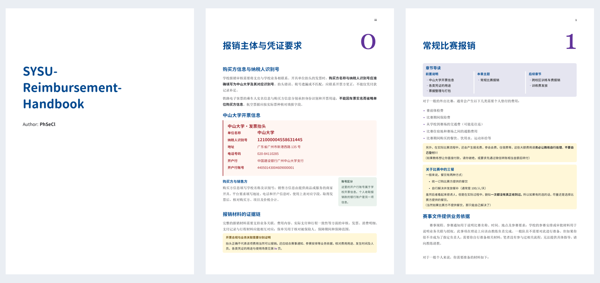

# SYSU-Reimbursement-Handbook

**中大网球队比赛报销手册 · PhSeCl**

从发票抬头、凭证留存到材料整理与行程说明，一本写给代表学校参赛的队员的报销手册。把费用、票据和实际行程对应起来，让材料准备更清楚，让反复补交更少一些。



## 手册内容

| 章节 | 阅读内容 |
| --- | --- |
| [序章 · 报销主体与凭证要求](latex/chapters/prologue.tex) | 中山大学开票信息；发票、小票、付款记录、行程单与保单的用途和图例 |
| [第一章 · 常规比赛报销](latex/chapters/chapter-1.tex) | 费用分类、票据整理、个人报销汇总表、特殊行程说明与提交前核对 |
| [第二章 · 跨校区训练车费报销](latex/chapters/chapter-2.tex) | 校车发票、费用汇总、单程情况说明与报销进度沟通 |

书中附有[个人报销汇总表](latex/examples/reimbursement-summary/main.tex)和[跨校区训练车费汇总表](latex/examples/cross-campus-summary/main.tex)的 LaTeX 示例，可按实际情况填写。

> 本手册由队员根据实际经历整理。具体费用范围、办理条件和期限，以学校现行规定及经办部门要求为准。

## 阅读与编译

手册使用 LaTeX 编写，以 XeLaTeX 排版。编译需要 TeX Live（含 `latexmk`、`ctex` 等宏包）、PowerShell 7 和 [uv](https://docs.astral.sh/uv/)。

在仓库根目录运行：

```powershell
pwsh -NoProfile -File scripts/build-handbook.ps1
```

生成的手册位于 `output/pdf/SYSU-Reimbursement-Handbook.pdf`，两份汇总表示例也会一并导出。

字体采用宋体正文、思源圆体标题，搭配 Georgia 与 Consolas。思源圆体随仓库提供；宋体、Georgia、Consolas 由本机提供。其他系统需自行安装合法字体，或在 `latex/handbook.sty` 及两份示例中调整字体设置。

## 反馈与修订

欢迎通过 [Issues](https://github.com/PhSeCl/SYSU-Reimbursement-Handbook/issues) 提出勘误、补充规则出处或反馈办理经验，也欢迎直接提交 LaTeX 修订。涉及政策变更时，请附适用条件、时间及可核对的来源。

提交图例前，请完整遮盖姓名、证件、联系方式、账号、订单编号、二维码及非必要行程信息，使用不透明色块并导出为新的扁平化图片。

## 许可与致谢

© 2026 **PhSeCl**。手册原创正文、`latex/` 中的文档与排版源码（字体除外）、README 及 `docs/` 中的原创展示内容采用 [CC BY-NC-SA 4.0](LICENSE)（知识共享署名—非商业性使用—相同方式共享 4.0 国际许可协议）。

你可以在非商业用途下分享与改编这些内容；请注明作者 **PhSeCl**、[本仓库](https://github.com/PhSeCl/SYSU-Reimbursement-Handbook)和[许可链接](https://creativecommons.org/licenses/by-nc-sa/4.0/deed.zh-hans)，说明是否作出修改，并以相同许可分享改编内容。商业使用需另行取得授权。

`scripts/` 中的构建与校验工具继续采用 [MIT License](scripts/LICENSE)。思源圆体采用 SIL OFL 1.1；票据、平台和系统界面中的第三方内容不在上述授权范围内，详见[第三方说明](THIRD_PARTY.md)。此前已按 MIT 发布的版本，其原有授权继续有效。
